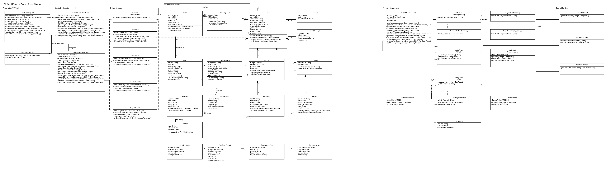
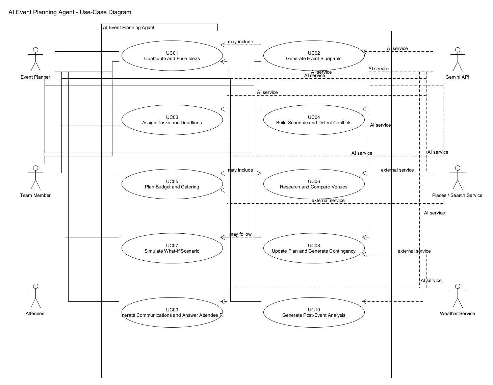
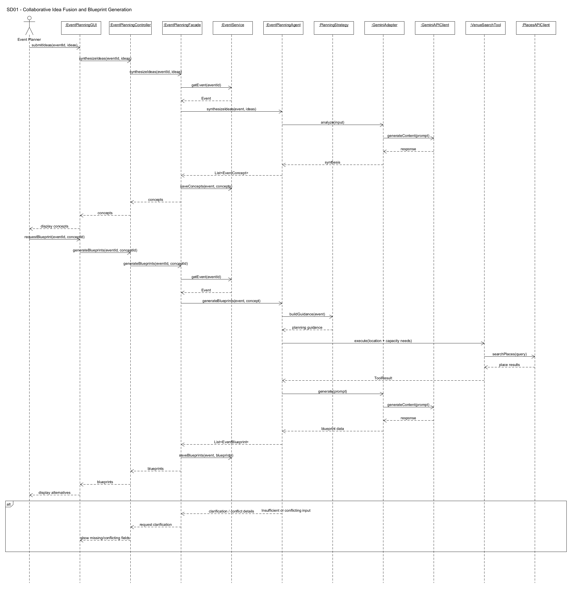
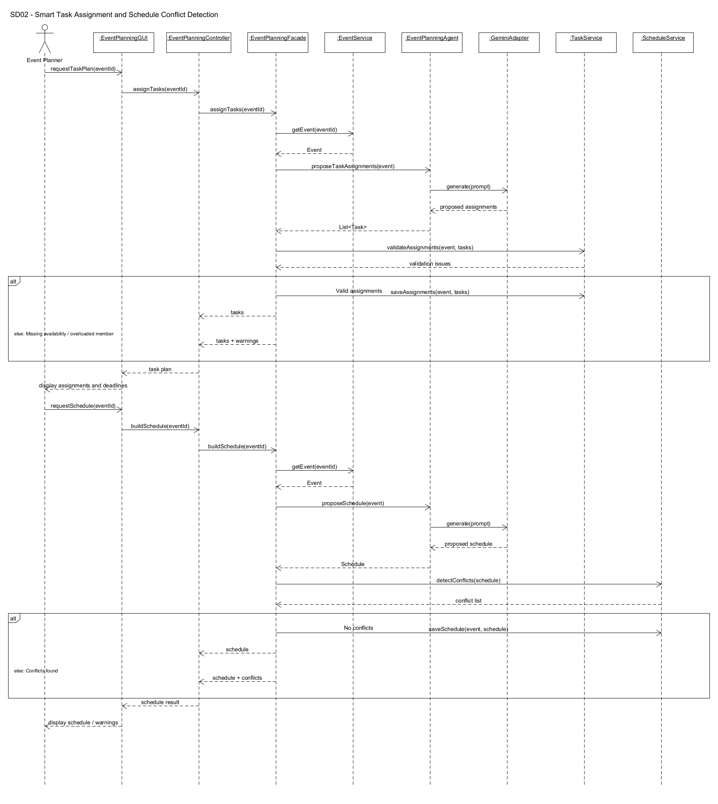
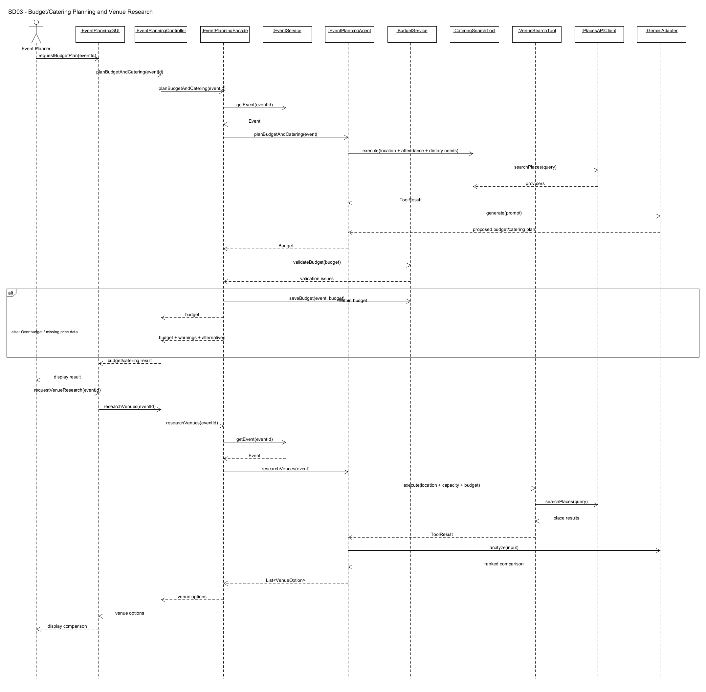
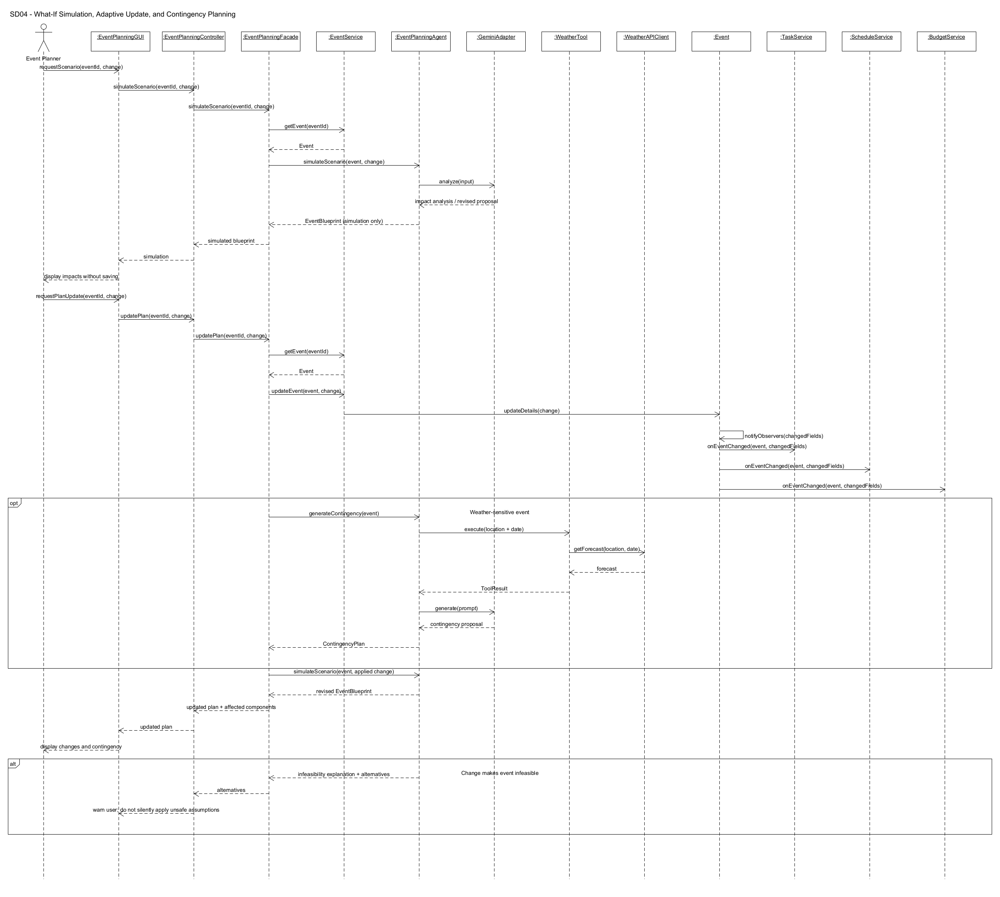
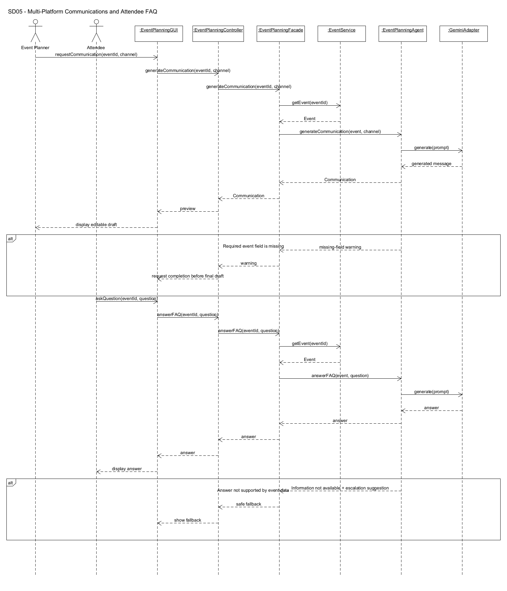
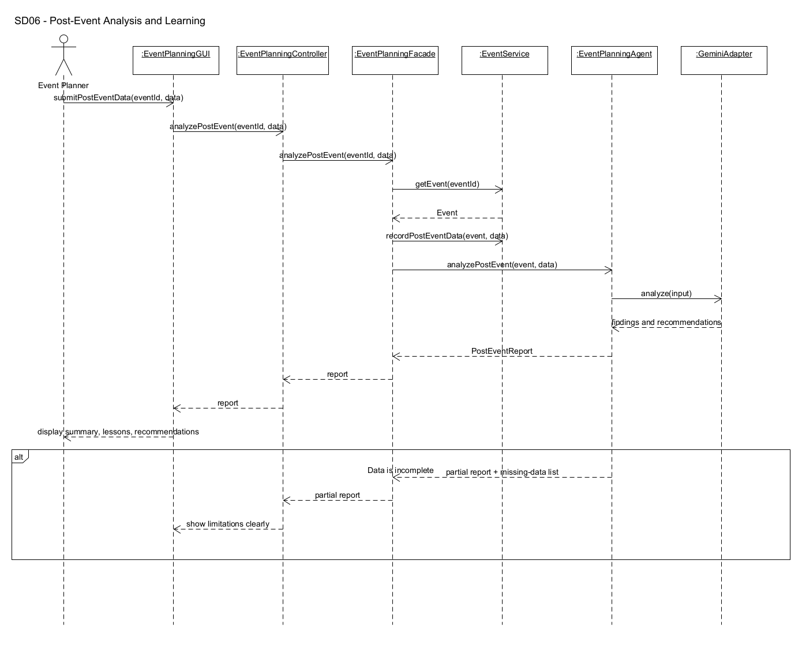

# EECS 3311 Fall 2026 - Course Project Stage 1

## AI Event Planning Agent for University Clubs

# Task 1: Define Your Agent Project

## 1.1 Project Description

### What problem does the project solve?

The idea for this project is an AI event planning agent made mainly for university clubs and other small groups. University students normally have a lot going on between classes, assignments, jobs, and other extracurriculars. Because of this, even a club with a fairly large executive team can still have trouble getting everyone involved in planning an event. A lot of the work can end up being handled by only a few people.

Planning an event also has a lot of parts that depend on each other. For example, changing the expected attendance can affect the venue, catering, budget, number of volunteers, and schedule. A date change can affect speaker availability and deadlines. The goal of this project is to make that planning process easier by helping a team organize its ideas and turn them into a realistic plan.

The agent is not meant to replace the people running the club. The planners will still make the final decisions. The agent is meant to reduce some of the repetitive planning work, point out conflicts, and help the team consider things they may have missed.

### Who are the target users?

The main target users are university clubs and student organizations. It could also be used by smaller community groups or individual students who are trying to plan an event without having a dedicated event planning team.

Within a club, the main users would be executive members or event coordinators. Team members can contribute ideas and availability information, while the main planner can review and approve the plans generated by the system. Event attendees can also use the FAQ feature to ask questions about an approved event.

### What can the agent do?

The agent will take in information such as the event type, goals, expected attendance, budget, date and time, location, organizer availability, dietary needs, accessibility needs, and other constraints. It will then help with different stages of planning. Some of its main abilities include:

- combining ideas submitted by different team members;
- generating multiple event blueprints;
- checking whether an event idea is realistic based on its constraints;
- creating and assigning planning tasks;
- suggesting an agenda and checking schedule conflicts;
- planning a budget and catering approach;
- researching possible venues;
- simulating "what-if" changes without changing the real plan;
- updating an existing plan when a real change happens;
- generating contingency plans for possible problems;
- drafting event communications and answering attendee FAQs;
- producing a post-event summary with lessons for future events.

The system will also keep the event information as context so that a user does not have to explain the whole event again every time they use a different feature.

### Why is an AI agent appropriate for this problem?

An AI agent is useful for this problem because event planning is not just one question followed by one answer. It involves multiple steps, changing information, and decisions that affect other parts of the plan. A normal application could store event data and calculate things such as budget totals, but it would be much harder to combine natural-language ideas, compare trade-offs, generate alternative plans, and explain why a change affects the rest of the event.

The agent can reason over the current event information, decide when it needs an external tool, use the returned information, and then continue planning. For example, it could receive an event idea, search for possible venues, use those results while creating a blueprint, and then pass the proposed budget and schedule to deterministic services for validation. This gives the project actual agent behaviour instead of only sending one prompt to an LLM and displaying the response.

### Which AI/LLM model(s) will be used?

Google Gemini is planned as the main LLM used by the actual system. It will be used for tasks such as understanding natural-language input, combining ideas, reasoning about constraints, generating plans, and summarizing results. Gemini was chosen because it has an accessible API and works well with the type of tool-based workflow planned for this project.

The system will not assume that Gemini automatically knows current venue prices, catering options, or weather. When current information is needed, the agent will use separate tools such as `VenueSearchTool`, `CateringSearchTool`, and `WeatherTool`, and then give the retrieved information to Gemini as context.

Claude may also be used while developing the project to help with coding, debugging, and understanding parts of the implementation. It is not planned as a runtime part of the final software system.

### How will the AI model interact with the rest of the software system?

The AI model will be one part of the system rather than the entire system. Both the GUI and CLI send requests to `EventPlanningController`. The controller delegates the request to `EventPlanningFacade`, which coordinates the normal system services and the `EventPlanningAgent`.

The agent uses the `AIModel` interface when it needs language understanding or generation. `GeminiAdapter` implements this interface and translates the application's requests into calls to the external Gemini API. The agent can also call tools for venue, catering, and weather information. After the AI produces a proposal, classes such as `TaskService`, `ScheduleService`, and `BudgetService` can perform deterministic checks before information is saved.

A typical request will follow this general flow:

```text
User
  -> GUI or CLI
  -> EventPlanningController
  -> EventPlanningFacade
  -> EventPlanningAgent and/or system services
  -> Gemini or an external tool when needed
  -> validation by system services
  -> result returned to the user
```

This way, the LLM is mainly responsible for reasoning and natural-language tasks, while the rest of the application is responsible for storing data, checking rules, and making approved changes to the event.

### GUI and CLI

The project will include both interfaces required for the assignment. The GUI will be the main event dashboard, where the user can view the event plan, tasks, budget, schedule, venue options, and AI-generated results. The CLI will provide access to the same major features through commands. Both interfaces use the same controller so that the event-planning logic does not have to be implemented twice.

Some example CLI commands could be:

```text
ideas fuse EVENT123
blueprint generate EVENT123 CONCEPT2
tasks assign EVENT123
schedule build EVENT123
budget plan EVENT123
venues research EVENT123
scenario simulate EVENT123 "attendance increases to 150"
plan update EVENT123 "speaker cancelled"
communication generate EVENT123 instagram
faq ask EVENT123 "Is the event accessible?"
postevent analyze EVENT123
```

### Main event information stored by the system

Depending on the event, the system can store information such as:

- event name and type;
- purpose and goals;
- target audience;
- expected attendance;
- budget and currency;
- preferred date and time;
- location preferences;
- venue requirements;
- accessibility needs;
- food and dietary requirements;
- equipment requirements;
- organizer skills and availability;
- volunteers and other available resources;
- speaker information and availability;
- ideas submitted by team members;
- university or club restrictions.

Not every field has to be filled for every feature. If a feature needs information that has not been provided, the system should ask the user for it instead of making up an important constraint.

## 1.2 Feature Specification

### F01 — Collaborative Idea Fusion

1. **Feature ID and Name:** F01 — Collaborative Idea Fusion

2. **Description:** Multiple organizers can submit event ideas independently. The agent identifies common themes, unique suggestions, incompatible suggestions, and possible compromises, then creates several coherent `EventConcept` objects.

3. **User Interaction:** Through the GUI's **Ideas** section, team members add suggestions and the planner selects **Fuse Ideas**. The CLI provides the equivalent `ideas fuse` command.

4. **Input:** Event goals, team-member ideas, preferred activities, themes, constraints, budget range, target audience, and available resources.

5. **Output:** A list of event concepts containing a title, summary, incorporated ideas, conflicts, and compromises.

6. **AI Involvement:** **AI-based.** The LLM interprets and synthesizes natural-language submissions.

7. **Expected Workflow:** The controller retrieves the event, passes the ideas and constraints to the agent, the agent asks the AI model to synthesize them, the resulting concepts are stored with the event, and the GUI displays them for selection or revision.

8. **Error / Alternative Cases:** If ideas are missing, the system requests more input. If suggestions conflict, the conflict is shown rather than silently ignored. If the model output cannot be parsed into valid concepts, the system retries once with a stricter structured prompt and otherwise reports a generation error.

### F02 — Event Blueprint and Feasibility Generation

1. **Feature ID and Name:** F02 — Event Blueprint and Feasibility Generation

2. **Description:** The agent converts a selected concept and the event constraints into multiple organized event blueprints. A blueprint includes an agenda outline, venue requirements, catering assumptions, checklist items, major resource needs, and feasibility warnings.

3. **User Interaction:** The planner selects an event concept and presses **Generate Blueprints**. The planner may choose a priority such as budget, community, or attendance before generation.

4. **Input:** Selected `EventConcept`, attendance, budget, date/time, goals, location preferences, resources, accessibility requirements, staffing, and other constraints.

5. **Output:** Two or more `EventBlueprint` alternatives with assumptions and feasibility warnings.

6. **AI Involvement:** **Hybrid.** AI performs planning and synthesis; deterministic services validate known constraints. External tools may provide supporting venue information.

7. **Expected Workflow:** The agent selects the chosen `PlanningStrategy`, gathers relevant tool context, builds a planning prompt, invokes Gemini, converts the result into blueprint objects, validates them, and returns the alternatives to the planner.

8. **Error / Alternative Cases:** If constraints are mutually incompatible, the system explains the conflict and identifies which constraints could be relaxed. If external data is unavailable, the blueprint is marked as using assumptions that require manual confirmation.

### F03 — Smart Task Assignment and Deadline Tracking

1. **Feature ID and Name:** F03 — Smart Task Assignment and Deadline Tracking

2. **Description:** The system creates planning tasks and recommends assignments based on member skills, availability, preferences, workload, and task deadlines.

3. **User Interaction:** The planner opens the **Tasks** panel and selects **Generate Task Plan**. Suggested assignments can be manually changed before approval. Team members can view their assigned tasks.

4. **Input:** Event blueprint, team members, member skills, availability, preferences, existing workload, event date, and required planning activities.

5. **Output:** A list of `Task` objects with assignees, deadlines, priorities, and validation warnings.

6. **AI Involvement:** **Hybrid.** AI proposes useful tasks and suitable assignments; `TaskService` deterministically checks availability and workload constraints that are represented in the system.

7. **Expected Workflow:** The agent proposes tasks and assignments, `TaskService.validateAssignments()` checks them, warnings are returned if necessary, and approved assignments are stored.

8. **Error / Alternative Cases:** If no suitable member exists for a task, it remains unassigned. If a member is overloaded or unavailable, the system flags the assignment and suggests another member or a revised deadline.

### F04 — Agenda / Session Scheduling and Conflict Detection

1. **Feature ID and Name:** F04 — Agenda / Session Scheduling and Conflict Detection

2. **Description:** The system proposes an event schedule containing sessions, breaks, speakers, setup/teardown periods, and other activities, then checks for time/resource conflicts.

3. **User Interaction:** The planner opens the **Schedule** panel and selects **Build Schedule**. Conflicts are highlighted and the planner can request a revised schedule.

4. **Input:** Event date/time, desired sessions, session duration, speaker availability, organizer availability, setup/teardown time, breaks, and venue restrictions.

5. **Output:** A `Schedule` containing `Session` objects plus a list of detected conflicts or warnings.

6. **AI Involvement:** **Hybrid.** AI proposes an effective agenda; `ScheduleService.detectConflicts()` performs deterministic overlap and availability checks.

7. **Expected Workflow:** The agent generates a proposed schedule, the schedule service checks overlaps and unavailable speakers/resources, and the GUI displays either the validated schedule or the schedule with conflict warnings.

8. **Error / Alternative Cases:** Missing availability is reported. If no conflict-free schedule exists, the system explains the blocking constraints instead of forcing an invalid schedule.

### F05 — Budget and Catering Planning

1. **Feature ID and Name:** F05 — Budget and Catering Planning

2. **Description:** The system proposes a categorized event budget and a catering approach based on attendance, dietary needs, event type, and available funds. The agent can retrieve possible catering providers for context.

3. **User Interaction:** The planner selects **Plan Budget & Catering** from the budget panel and can edit individual `BudgetItem` allocations after generation.

4. **Input:** Total budget, expected attendance, event duration, food requirements, dietary restrictions, preferred area, known fixed costs, and event priorities.

5. **Output:** A `Budget` containing `BudgetItem` objects, a catering recommendation, provider options when available, and over-budget warnings.

6. **AI Involvement:** **Hybrid.** AI proposes allocations and catering choices; `BudgetService` calculates totals and validates that allocations do not exceed the stated budget.

7. **Expected Workflow:** The agent invokes `CateringSearchTool` when provider information is useful, Gemini proposes the plan, and `BudgetService.validateBudget()` verifies the numerical totals before the plan is stored.

8. **Error / Alternative Cases:** Missing or uncertain prices are labelled as estimates. If the proposed plan exceeds the budget, the system shows the shortfall and suggests areas to reduce rather than silently changing the user's budget.

### F06 — Venue Research and Comparison

1. **Feature ID and Name:** F06 — Venue Research and Comparison

2. **Description:** The agent searches for possible venues and compares them against capacity, location, estimated cost, accessibility, and other event requirements.

3. **User Interaction:** The planner selects **Research Venues** from the event dashboard and can view a comparison of the returned `VenueOption` objects.

4. **Input:** Location or preferred area, expected attendance, budget limit, event type, accessibility needs, equipment needs, and venue constraints.

5. **Output:** Ranked venue options with relevant retrieved details, fit explanations, and any missing information that still requires confirmation.

6. **AI Involvement:** **Hybrid.** `VenueSearchTool` retrieves external information and the LLM interprets the results against the event's constraints.

7. **Expected Workflow:** The agent sends a structured query to the venue-search tool, receives external results, asks the AI model to compare them, and returns the resulting venue options to the GUI.

8. **Error / Alternative Cases:** If the external service is unavailable, the user receives an error and may retry later or manually enter a venue. Missing availability or price data is explicitly marked as unknown.

### F07 — What-If Scenario Simulator

1. **Feature ID and Name:** F07 — What-If Scenario Simulator

2. **Description:** The planner can test a hypothetical change, such as increased attendance or a lower budget, and see how it would affect the event without altering the approved plan.

3. **User Interaction:** The planner selects **What If?** and enters a natural-language change such as “What if attendance increases from 80 to 150?”

4. **Input:** Current event plan and the proposed hypothetical change.

5. **Output:** A simulated `EventBlueprint` describing affected areas, revised assumptions, resource impacts, estimated budget effects, and recommended changes.

6. **AI Involvement:** **Hybrid.** AI interprets the change and reasons about dependencies; deterministic services can be consulted for budget or schedule validation.

7. **Expected Workflow:** The existing event is copied logically for simulation, the agent applies the hypothetical constraint to the simulated context, produces a revised blueprint, and returns it without saving the change to the real event.

8. **Error / Alternative Cases:** Ambiguous changes trigger clarification. If the scenario is infeasible, the system explains why. The actual event is never modified by this feature.

### F08 — Adaptive Plan Update and Contingency Generation

1. **Feature ID and Name:** F08 — Adaptive Plan Update and Contingency Generation

2. **Description:** When a real event detail changes, the system updates the stored event, identifies affected parts of the plan, revalidates tasks/schedule/budget, and can generate a contingency plan for risks such as weather, speaker cancellation, venue problems, or catering delays.

3. **User Interaction:** The planner selects **Update Plan**, describes the real change, reviews the affected components, and confirms the update. Contingencies are shown in a dedicated risk panel.

4. **Input:** Existing event, confirmed change, current tasks, schedule, budget, relevant external conditions, and known risks.

5. **Output:** Updated event data, revised blueprint, revalidation warnings, and one or more `ContingencyPlan` objects.

6. **AI Involvement:** **Hybrid.** The AI reasons about downstream effects and generates contingency responses. The Observer pattern causes deterministic services to revalidate affected data after the event changes. Weather information may be retrieved through `WeatherTool`.

7. **Expected Workflow:** `EventService.updateEvent()` applies the approved change. `Event.notifyObservers()` notifies `TaskService`, `ScheduleService`, and `BudgetService`. The agent then generates revised planning recommendations and contingency plans.

8. **Error / Alternative Cases:** If the change makes the event infeasible, the system presents alternatives and clearly identifies unresolved constraints. If an external tool fails, the contingency is labelled as based only on known local data.

### F09 — Multi-Platform Communications and Attendee FAQ

1. **Feature ID and Name:** F09 — Multi-Platform Communications and Attendee FAQ

2. **Description:** The agent generates event communications tailored to different channels and answers attendee questions using approved event information.

3. **User Interaction:** A planner selects a platform such as email, Instagram, or group chat and requests a draft. Attendees can enter questions in the FAQ interface. Generated planner communications are editable before use.

4. **Input:** Approved event facts, target audience, communication channel, desired tone, registration details, and attendee question when applicable.

5. **Output:** `Communication` drafts and natural-language FAQ answers.

6. **AI Involvement:** **AI-based with deterministic grounding.** The LLM generates language, but the application supplies only approved event data as factual context.

7. **Expected Workflow:** The event is retrieved, the approved facts are passed to the AI model, and a channel-specific draft or grounded FAQ answer is returned.

8. **Error / Alternative Cases:** If required event information is missing, the system asks the planner to complete it. If an attendee asks for information not present in the event data, the agent responds that the information is unavailable rather than fabricating an answer.

### F10 — Post-Event Analysis and Learning

1. **Feature ID and Name:** F10 — Post-Event Analysis and Learning

2. **Description:** After the event, the system compares the plan with actual outcomes and produces a report containing successes, issues, lessons, and recommendations for future events.

3. **User Interaction:** The planner selects **Post-Event Review**, enters actual attendance, final expenses, feedback, and problems encountered, then generates the report.

4. **Input:** Original event plan, actual attendance, final expenses, organizer feedback, attendee feedback, completed/unfinished tasks, and problems encountered.

5. **Output:** A `PostEventReport` containing summary, successes, issues, lessons, and future recommendations.

6. **AI Involvement:** **Hybrid.** Deterministic values such as budget variance and attendance difference can be calculated directly; the LLM analyzes qualitative feedback and generates lessons.

7. **Expected Workflow:** Post-event data is stored, the agent compares it with the original plan, Gemini analyzes the qualitative information, and a structured report is returned and attached to the event.

8. **Error / Alternative Cases:** If data is incomplete, the system produces a partial report and identifies missing information. Conflicting feedback is summarized as differing perspectives rather than forcing a single conclusion.


# Task 2: Design Your System Using UML

## 2.1 Class Diagram



The class diagram includes:

- GUI and CLI boundary classes;
- the MVC controller;
- the application facade;
- traditional service classes;
- event-planning domain classes;
- AI/agent classes and interfaces;
- external service clients;
- associations and dependencies;
- inheritance/interface realization;
- aggregation and composition;
- multiplicities;
- the classes required by the five selected design patterns.

### Main Structural Relationships

The most important relationships are:

```text
EventPlanningGUI ----> EventPlanningController <---- EventPlanningCLI
                               |
                               v
                    EventPlanningFacade
                     /                \
                    v                  v
             System Services       EventPlanningAgent
                    |                    |
                    v                    +--> PlanningStrategy
              Domain Model               +--> AIModel --> GeminiAdapter --> Gemini API
                                         +--> AITool --> External Services
```

Some of the main relationships shown in the class diagram are:

- `PlanningTeam` aggregates one or more `User` objects.
- A `PlanningTeam` plans zero or more `Event` objects.
- `Event` composes its ideas, concepts, blueprints, tasks, budget, schedule, contingencies, communications, and optional post-event report.
- `Budget` composes zero or more `BudgetItem` objects.
- `Schedule` composes zero or more `Session` objects.
- `Task` may be assigned to one `User`.
- `Session` may have one `Speaker`.
- `Speaker` aggregates availability represented by `TimeSlot` objects.


### Design Patterns Used

The design uses five patterns that each solve a specific problem in the system: MVC, Facade, Strategy, Observer, and Adapter.

#### MVC (Model-View-Controller)

**Design problem:**

The application must support both a graphical interface and a command-line interface while keeping user-interface code separate from event-planning logic. If the interfaces directly manipulated domain objects and called AI services, logic would be duplicated and changes to the UI could affect the rest of the system.

**Participating classes and roles:**

- `EventPlanningGUI` — **View** for graphical interaction.
- `EventPlanningCLI` — **View** for command-line interaction.
- `EventPlanningController` — **Controller** that receives requests from either view and delegates them to the facade.
- Domain classes such as `Event`, `Task`, `Budget`, `Schedule`, and `EventBlueprint` — **Model** representing application data.
- System services operate on the model and enforce deterministic rules.

**Why this pattern is appropriate:**

The project explicitly requires both GUI and CLI access to major functionality. MVC allows both interfaces to reuse the same controller and model rather than duplicating planning logic.

**What would be harder without it:**

The GUI and CLI could each contain their own event-planning logic, increasing duplication and inconsistency. Testing the business logic independently of the interface would also be more difficult.

#### Facade

**Design problem:**

A single feature can require several components. For example, updating an event may involve `EventService`, `BudgetService`, `ScheduleService`, `TaskService`, and `EventPlanningAgent`. The controller should not need to understand all internal coordination details.

**Participating classes and roles:**

- `EventPlanningFacade` — **Facade** exposing high-level event-planning operations.
- `EventService`, `TaskService`, `ScheduleService`, `BudgetService` — subsystem classes performing deterministic operations.
- `EventPlanningAgent` — subsystem class performing AI/agent operations.
- `EventPlanningController` — client of the facade.

**Why this pattern is appropriate:**

The facade gives the controller a stable set of high-level operations such as `generateBlueprints()`, `assignTasks()`, `simulateScenario()`, and `updatePlan()` while hiding coordination among services and AI components.

**What would be harder without it:**

`EventPlanningController` would need direct knowledge of every service and the order in which they must be called. This would increase coupling and make changes to internal workflows more difficult.

#### Strategy

**Design problem:**

Different events may prioritize different objectives. One club may primarily care about minimizing cost, another about building community, and another about maximizing attendance. The AI agent should be able to change planning emphasis without becoming a large block of conditional logic.

**Participating classes and roles:**

- `PlanningStrategy` — **Strategy interface** defining `buildGuidance(event)`.
- `BudgetPriorityStrategy` — concrete strategy emphasizing affordability and cost trade-offs.
- `CommunityPriorityStrategy` — concrete strategy emphasizing interaction, inclusiveness, and community building.
- `AttendancePriorityStrategy` — concrete strategy emphasizing capacity, accessibility, and attendance growth.
- `EventPlanningAgent` — **Context** that stores and uses the selected strategy.

**Why this pattern is appropriate:**

Planning priorities are expected to vary by event. Strategy allows the planning approach to be selected at runtime while keeping the agent's core workflow unchanged.

**What would be harder without it:**

`EventPlanningAgent` would require repeated `if/else` or `switch` logic for every possible planning priority. Adding a new planning approach would require editing the agent itself instead of adding a new strategy class.

#### Observer

**Design problem:**

A real change to an event can affect several parts of the plan. For example, increasing attendance can invalidate the budget, task workload, or schedule assumptions. These components should be revalidated when relevant event fields change.

**Participating classes and roles:**

- `Event` — **Subject/Publisher** that stores observers and calls `notifyObservers()` after an approved update.
- `EventObserver` — **Observer interface** defining `onEventChanged()`.
- `TaskService` — concrete observer responsible for task-plan revalidation.
- `ScheduleService` — concrete observer responsible for schedule revalidation.
- `BudgetService` — concrete observer responsible for budget revalidation.

**Why this pattern is appropriate:**

The system is highly interconnected. Observer allows services to react to event changes without hard-coding every service into the event-update workflow.

**What would be harder without it:**

`EventService` or `Event` would need to explicitly call every affected service. Adding a new dependent component would require modifying the publisher, creating tighter coupling.

#### Adapter

**Design problem:**

The application should depend on an internal AI interface instead of directly depending on Gemini-specific API calls. The exact external API may change or another model may later be substituted.

**Participating classes and roles:**

- `AIModel` — **Target interface** expected by the application.
- `GeminiAdapter` — **Adapter** implementing `AIModel` and translating application requests to Gemini API calls.
- `GeminiAPIClient` — **Adaptee** representing the external Gemini client/API.
- `EventPlanningAgent` — **Client** that depends only on `AIModel`.

**Why this pattern is appropriate:**

The agent should reason in terms of application operations such as `generate()`, `analyze()`, and `summarize()` rather than vendor-specific API details. The adapter isolates those details.

**What would be harder without it:**

Gemini-specific calls would be spread throughout the agent. Switching providers, changing API versions, or creating a mock AI model for testing would require larger changes to the application.


## 2.2 Use-Case Diagram and Use-Case Descriptions



The primary actor is the **Event Planner**. Additional actors are **Team Member**, **Attendee**, **Gemini API**, **Places/Search Service**, and **Weather Service**. The ten use cases correspond directly to the ten major features.


### UC01 — Contribute and Fuse Ideas

- **Actor(s):** Event Planner, Team Member, Gemini API
- **Goal:** Combine ideas from multiple organizers into coherent event concepts.
- **Preconditions:** An event exists; at least one user has permission to contribute ideas.
- **Trigger:** The planner selects **Fuse Ideas** after ideas have been entered.
- **Main Success Scenario:**
  1. Users submit event ideas through the GUI or CLI.
  2. The controller sends the request to `EventPlanningFacade.synthesizeIdeas()`.
  3. `EventService` retrieves the event and its constraints.
  4. `EventPlanningAgent.synthesizeIdeas()` sends the ideas and constraints to the AI model.
  5. Gemini returns a structured synthesis.
  6. The agent converts the response into `EventConcept` objects.
  7. The concepts are saved and displayed.
- **Alternative / Exception Flows:** Missing ideas cause a request for more input. Conflicting ideas are returned as explicit conflicts. Invalid AI output is retried or reported.
- **Postconditions:** One or more event concepts are stored with the event.
- **Related Feature(s):** F01

### UC02 — Generate Event Blueprints

- **Actor(s):** Event Planner, Gemini API, Places/Search Service
- **Goal:** Produce multiple feasible event-plan alternatives from a selected concept.
- **Preconditions:** An event and at least one `EventConcept` exist.
- **Trigger:** The planner selects a concept and requests blueprint generation.
- **Main Success Scenario:**
  1. The controller retrieves the event and selected concept.
  2. The agent loads the selected `PlanningStrategy`.
  3. The strategy provides planning guidance.
  4. The agent invokes external tools when venue/context data is useful.
  5. The AI model generates structured blueprint alternatives.
  6. The system validates required fields and assumptions.
  7. The blueprints are saved and displayed.
- **Alternative / Exception Flows:** Conflicting constraints result in an infeasibility explanation. Missing external data is marked as an assumption requiring confirmation.
- **Postconditions:** One or more `EventBlueprint` objects are available for review.
- **Related Feature(s):** F02

### UC03 — Assign Tasks and Deadlines

- **Actor(s):** Event Planner, Team Member, Gemini API
- **Goal:** Create and assign planning tasks while respecting team availability and workload.
- **Preconditions:** An event exists and team members have been added.
- **Trigger:** The planner selects **Generate Task Plan**.
- **Main Success Scenario:**
  1. The event and team information are retrieved.
  2. The agent proposes planning tasks, assignees, deadlines, and priorities.
  3. `TaskService.validateAssignments()` checks availability and workload.
  4. Valid assignments are saved.
  5. The GUI displays tasks to the planner and assigned members.
- **Alternative / Exception Flows:** Unsuitable assignments are flagged. Tasks can remain unassigned if no appropriate member is available.
- **Postconditions:** A validated task plan is attached to the event.
- **Related Feature(s):** F03

### UC04 — Build Schedule and Detect Conflicts

- **Actor(s):** Event Planner, Gemini API
- **Goal:** Produce an agenda/session schedule and identify time conflicts.
- **Preconditions:** The event date/time and required activities are known sufficiently to attempt scheduling.
- **Trigger:** The planner selects **Build Schedule**.
- **Main Success Scenario:**
  1. The event's timing, sessions, speakers, and availability are retrieved.
  2. The agent proposes a `Schedule`.
  3. `ScheduleService.detectConflicts()` checks overlapping sessions and unavailable speakers/resources.
  4. A conflict-free schedule is stored and displayed.
- **Alternative / Exception Flows:** If conflicts exist, they are displayed with the proposed schedule so the user can revise constraints or request regeneration.
- **Postconditions:** A schedule is stored or conflict information is returned for revision.
- **Related Feature(s):** F04

### UC05 — Plan Budget and Catering

- **Actor(s):** Event Planner, Gemini API, Places/Search Service
- **Goal:** Build a realistic categorized budget and catering plan.
- **Preconditions:** A total budget and expected attendance are available.
- **Trigger:** The planner selects **Plan Budget & Catering**.
- **Main Success Scenario:**
  1. The event and budget constraints are retrieved.
  2. The agent optionally retrieves catering-provider context.
  3. Gemini proposes categories, allocations, and catering recommendations.
  4. The agent constructs a `Budget` and `BudgetItem` objects.
  5. `BudgetService.validateBudget()` verifies totals.
  6. The result is saved and displayed.
- **Alternative / Exception Flows:** Over-budget plans are returned with warnings and alternatives. Unknown prices remain explicitly marked as estimates.
- **Postconditions:** A budget/catering plan is stored or returned for revision.
- **Related Feature(s):** F05

### UC06 — Research and Compare Venues

- **Actor(s):** Event Planner, Gemini API, Places/Search Service
- **Goal:** Find venues that fit event constraints and compare trade-offs.
- **Preconditions:** At minimum, a general location and expected attendance are available.
- **Trigger:** The planner selects **Research Venues**.
- **Main Success Scenario:**
  1. The agent constructs a venue-search query from the event constraints.
  2. `VenueSearchTool` calls the external places service.
  3. Retrieved results are returned to the agent.
  4. Gemini compares the venues against capacity, cost, accessibility, and other constraints.
  5. Ranked `VenueOption` objects are shown to the planner.
- **Alternative / Exception Flows:** External-service failure produces a retry/manual-entry option. Unknown cost or availability is clearly identified.
- **Postconditions:** Venue options are available for consideration; no venue is automatically booked.
- **Related Feature(s):** F06

### UC07 — Simulate What-If Scenario

- **Actor(s):** Event Planner, Gemini API
- **Goal:** Understand the effect of a hypothetical change without changing the stored event.
- **Preconditions:** An event plan exists.
- **Trigger:** The planner enters a hypothetical change in the **What If?** interface.
- **Main Success Scenario:**
  1. The current event context is retrieved.
  2. The agent interprets the hypothetical change.
  3. The agent identifies affected components and generates a simulated revised blueprint.
  4. The simulation is displayed with impact explanations.
  5. The real event remains unchanged.
- **Alternative / Exception Flows:** Ambiguous input triggers clarification. Infeasible scenarios return an explanation and alternatives.
- **Postconditions:** A temporary simulated blueprint is returned; persistent event data is unchanged.
- **Related Feature(s):** F07

### UC08 — Update Plan and Generate Contingency

- **Actor(s):** Event Planner, Gemini API, Weather Service
- **Goal:** Apply a real change to an event, revalidate affected areas, and create appropriate contingency plans.
- **Preconditions:** An event exists and the planner has confirmed that the change is real rather than hypothetical.
- **Trigger:** The planner selects **Update Plan** and confirms the change.
- **Main Success Scenario:**
  1. `EventService.updateEvent()` applies the change.
  2. `Event.notifyObservers()` notifies task, schedule, and budget observers.
  3. The observer services revalidate their areas.
  4. The agent identifies downstream impacts.
  5. If appropriate, the agent invokes `WeatherTool` or other available tools.
  6. The agent generates a contingency plan and revised blueprint.
  7. The system displays all affected components and warnings.
- **Alternative / Exception Flows:** If the event becomes infeasible, the system reports why and provides alternatives. External-tool failure is disclosed.
- **Postconditions:** The confirmed event change is stored; affected planning components are flagged/revalidated; contingency information is attached where relevant.
- **Related Feature(s):** F08

### UC09 — Generate Communications and Answer Attendee FAQ

- **Actor(s):** Event Planner, Attendee, Gemini API
- **Goal:** Create channel-appropriate event communications and answer attendee questions from approved event facts.
- **Preconditions:** The event contains the facts needed for the requested communication or answer.
- **Trigger:** A planner requests a communication draft or an attendee asks a question.
- **Main Success Scenario:**
  1. The current event information is retrieved.
  2. The agent builds a prompt using approved facts only.
  3. Gemini generates either a communication draft or FAQ response.
  4. Planner communications are displayed as editable drafts; FAQ responses are displayed to the attendee.
- **Alternative / Exception Flows:** Missing required facts generate a request for completion. Unsupported attendee questions receive an “information not available” response rather than a fabricated answer.
- **Postconditions:** A communication draft or grounded attendee response is produced.
- **Related Feature(s):** F09

### UC10 — Generate Post-Event Analysis

- **Actor(s):** Event Planner, Gemini API
- **Goal:** Compare the planned event with actual outcomes and capture lessons for future planning.
- **Preconditions:** The event has occurred and at least some actual results are available.
- **Trigger:** The planner submits the post-event review form.
- **Main Success Scenario:**
  1. Actual attendance, expenses, feedback, and issues are recorded.
  2. The agent compares the actual data with the original plan.
  3. Deterministic differences such as budget variance are calculated where possible.
  4. Gemini analyzes qualitative feedback.
  5. The agent constructs a `PostEventReport`.
  6. The report is displayed and stored with the event.
- **Alternative / Exception Flows:** Incomplete data results in a partial report with clearly identified limitations. Conflicting feedback is preserved as differing perspectives.
- **Postconditions:** A post-event report is attached to the event.
- **Related Feature(s):** F10


## 2.3 Sequence Diagrams

I used six sequence diagrams to cover the ten features. Some related features are combined into the same sequence diagram because they use a similar set of classes.

| Sequence Diagram | Covered Features | Mermaid Source |
|---|---|---|
| **SD01 — Collaborative Idea Fusion and Blueprint Generation** | F01, F02 | [`sequence-SD01-ideas-blueprints.mmd`](diagrams/sequence-SD01-ideas-blueprints.mmd) |
| **SD02 — Smart Task Assignment and Schedule Conflict Detection** | F03, F04 | [`sequence-SD02-tasks-schedule.mmd`](diagrams/sequence-SD02-tasks-schedule.mmd) |
| **SD03 — Budget/Catering Planning and Venue Research** | F05, F06 | [`sequence-SD03-budget-venue.mmd`](diagrams/sequence-SD03-budget-venue.mmd) |
| **SD04 — What-If Simulation, Adaptive Update, and Contingency Planning** | F07, F08 | [`sequence-SD04-scenario-update-contingency.mmd`](diagrams/sequence-SD04-scenario-update-contingency.mmd) |
| **SD05 — Multi-Platform Communications and Attendee FAQ** | F09 | [`sequence-SD05-communications-faq.mmd`](diagrams/sequence-SD05-communications-faq.mmd) |
| **SD06 — Post-Event Analysis and Learning** | F10 | [`sequence-SD06-post-event.mmd`](diagrams/sequence-SD06-post-event.mmd) |

Each sequence diagram includes the initiating actor, GUI boundary, controller/facade, relevant domain or service objects, AI/agent components, external services when applicable, return values, and at least one relevant alternative/error path.


### SD01 — Collaborative Idea Fusion and Blueprint Generation




### SD02 — Smart Task Assignment and Schedule Conflict Detection




### SD03 — Budget/Catering Planning and Venue Research




### SD04 — What-If Simulation, Adaptive Update, and Contingency Planning




### SD05 — Multi-Platform Communications and Attendee FAQ




### SD06 — Post-Event Analysis and Learning




# Task 3: Feature-to-Design Traceability

| Feature | Description | Type | Related Use Case | Main Classes | Key Methods | Sequence Diagram | Design Pattern(s) |
|---|---|---|---|---|---|---|---|
| **F01** | Collaborative Idea Fusion | AI | UC01 | `EventPlanningGUI`, `EventPlanningController`, `EventPlanningFacade`, `EventService`, `EventPlanningAgent`, `AIModel`, `EventConcept` | `submitIdeas()`, `synthesizeIdeas()`, `analyze()`, `saveConcepts()` | SD01 | MVC, Facade, Adapter |
| **F02** | Blueprint & Feasibility Generation | Hybrid | UC02 | `EventPlanningAgent`, `PlanningStrategy`, `EventBlueprint`, `VenueSearchTool`, `AIModel` | `generateBlueprints()`, `buildGuidance()`, `execute()`, `generate()` | SD01 | Strategy, Adapter, Facade |
| **F03** | Smart Task Assignment | Hybrid | UC03 | `EventPlanningAgent`, `TaskService`, `Task`, `User` | `proposeTaskAssignments()`, `validateAssignments()`, `saveAssignments()` | SD02 | MVC, Facade |
| **F04** | Schedule & Conflict Detection | Hybrid | UC04 | `EventPlanningAgent`, `ScheduleService`, `Schedule`, `Session`, `Speaker`, `TimeSlot` | `proposeSchedule()`, `detectConflicts()`, `saveSchedule()` | SD02 | MVC, Facade |
| **F05** | Budget & Catering Planning | Hybrid | UC05 | `EventPlanningAgent`, `BudgetService`, `Budget`, `BudgetItem`, `CateringSearchTool` | `planBudgetAndCatering()`, `validateBudget()`, `saveBudget()`, `execute()` | SD03 | Facade, Adapter |
| **F06** | Venue Research & Comparison | Hybrid | UC06 | `EventPlanningAgent`, `VenueSearchTool`, `PlacesAPIClient`, `VenueOption`, `AIModel` | `researchVenues()`, `execute()`, `analyze()` | SD03 | Adapter, Facade |
| **F07** | What-If Scenario Simulator | Hybrid | UC07 | `EventPlanningController`, `EventPlanningFacade`, `EventPlanningAgent`, `EventBlueprint` | `simulateScenario()` | SD04 | MVC, Facade, Adapter |
| **F08** | Adaptive Plan Update & Contingency | Hybrid | UC08 | `EventService`, `Event`, `EventObserver`, `TaskService`, `ScheduleService`, `BudgetService`, `EventPlanningAgent`, `WeatherTool`, `ContingencyPlan` | `updateEvent()`, `notifyObservers()`, `onEventChanged()`, `generateContingency()` | SD04 | Observer, Facade, Adapter |
| **F09** | Communications & Attendee FAQ | AI | UC09 | `EventPlanningAgent`, `Communication`, `AIModel`, `EventService` | `generateCommunication()`, `answerFAQ()`, `generate()` | SD05 | MVC, Facade, Adapter |
| **F10** | Post-Event Analysis & Learning | Hybrid | UC10 | `EventService`, `EventPlanningAgent`, `PostEventReport`, `AIModel` | `recordPostEventData()`, `analyzePostEvent()`, `analyze()` | SD06 | MVC, Facade, Adapter |


# Task 4: Explain How Each Feature Is Realized

### F01 — Collaborative Idea Fusion

- **Related Use Case:** UC01 — Contribute and Fuse Ideas
- **Related Sequence Diagram:** SD01 — Collaborative Idea Fusion and Blueprint Generation
- **Classes involved:** `EventPlanningGUI` / `EventPlanningCLI`, `EventPlanningController`, `EventPlanningFacade`, `EventService`, `Event`, `EventPlanningAgent`, `AIModel`, `GeminiAdapter`, `EventConcept`.
- **Important methods:** `EventPlanningGUI.submitIdeas()`, `EventPlanningController.synthesizeIdeas()`, `EventPlanningFacade.synthesizeIdeas()`, `EventService.getEvent()`, `EventPlanningAgent.synthesizeIdeas()`, `AIModel.analyze()`, `EventService.saveConcepts()`.
- **Execution:** The interface sends the organizers' ideas to the controller. The facade retrieves the event and passes its constraints and submitted ideas to the agent. The agent uses the AI model to identify themes, conflicts, and possible combinations. Structured `EventConcept` objects are created, stored, and returned to the interface.

### F02 — Event Blueprint and Feasibility Generation

- **Related Use Case:** UC02 — Generate Event Blueprints
- **Related Sequence Diagram:** SD01 — Collaborative Idea Fusion and Blueprint Generation
- **Classes involved:** `EventPlanningController`, `EventPlanningFacade`, `EventService`, `EventPlanningAgent`, `PlanningStrategy`, concrete strategies, `VenueSearchTool`, `AIModel`, `EventBlueprint`.
- **Important methods:** `generateBlueprints()`, `PlanningStrategy.buildGuidance()`, `AITool.execute()`, `AIModel.generate()`, `EventService.saveBlueprints()`.
- **Execution:** The planner selects a concept and planning priority. The agent obtains guidance from the selected strategy and may retrieve external venue context. Gemini then produces structured blueprint alternatives. The application converts these into `EventBlueprint` objects, checks required fields and assumptions, and displays them for human review.

### F03 — Smart Task Assignment and Deadline Tracking

- **Related Use Case:** UC03 — Assign Tasks and Deadlines
- **Related Sequence Diagram:** SD02 — Smart Task Assignment and Schedule Conflict Detection
- **Classes involved:** `EventPlanningAgent`, `TaskService`, `Event`, `Task`, `User`.
- **Important methods:** `EventPlanningAgent.proposeTaskAssignments()`, `TaskService.validateAssignments()`, `TaskService.saveAssignments()`, `Task.assign()`.
- **Execution:** The agent reads the event blueprint, team skills, preferences, and availability and proposes planning tasks with deadlines. `TaskService` checks the proposal for invalid or overloaded assignments. Valid tasks are stored; problematic tasks are returned with warnings so the planner can adjust them.

### F04 — Agenda / Session Scheduling and Conflict Detection

- **Related Use Case:** UC04 — Build Schedule and Detect Conflicts
- **Related Sequence Diagram:** SD02 — Smart Task Assignment and Schedule Conflict Detection
- **Classes involved:** `EventPlanningAgent`, `ScheduleService`, `Schedule`, `Session`, `Speaker`, `TimeSlot`.
- **Important methods:** `EventPlanningAgent.proposeSchedule()`, `ScheduleService.detectConflicts()`, `ScheduleService.saveSchedule()`, `Speaker.checkAvailability()`, `TimeSlot.overlaps()`.
- **Execution:** The agent creates a proposed session structure from the event's requirements and availability information. The deterministic schedule service checks overlaps and unavailable participants/resources. A valid schedule is stored; otherwise, conflicts are displayed and the planner may revise inputs or regenerate.

### F05 — Budget and Catering Planning

- **Related Use Case:** UC05 — Plan Budget and Catering
- **Related Sequence Diagram:** SD03 — Budget/Catering Planning and Venue Research
- **Classes involved:** `EventPlanningAgent`, `BudgetService`, `Budget`, `BudgetItem`, `CateringSearchTool`, `PlacesAPIClient`, `AIModel`.
- **Important methods:** `EventPlanningAgent.planBudgetAndCatering()`, `CateringSearchTool.execute()`, `Budget.addBudgetItem()`, `BudgetService.validateBudget()`, `BudgetService.saveBudget()`.
- **Execution:** The agent retrieves catering options when useful and asks the AI model to create a categorized plan. The resulting budget is represented using `Budget` and `BudgetItem` objects. The budget service calculates totals and validates that the plan respects the user's budget before it is stored.

### F06 — Venue Research and Comparison

- **Related Use Case:** UC06 — Research and Compare Venues
- **Related Sequence Diagram:** SD03 — Budget/Catering Planning and Venue Research
- **Classes involved:** `EventPlanningAgent`, `VenueSearchTool`, `PlacesAPIClient`, `ToolResult`, `AIModel`, `VenueOption`.
- **Important methods:** `EventPlanningAgent.researchVenues()`, `VenueSearchTool.execute()`, `PlacesAPIClient.searchPlaces()`, `AIModel.analyze()`.
- **Execution:** The agent translates the event's venue requirements into a structured search. The venue tool retrieves candidates from the external places service. Gemini compares the retrieved candidates against the event's constraints, and the system returns ranked `VenueOption` objects with unknown or unverified data clearly identified.

### F07 — What-If Scenario Simulator

- **Related Use Case:** UC07 — Simulate What-If Scenario
- **Related Sequence Diagram:** SD04 — What-If Simulation, Adaptive Update, and Contingency Planning
- **Classes involved:** `EventPlanningGUI` / `EventPlanningCLI`, `EventPlanningController`, `EventPlanningFacade`, `EventService`, `EventPlanningAgent`, `EventBlueprint`.
- **Important methods:** `requestScenario()`, `simulateScenario()`, `EventService.getEvent()`.
- **Execution:** The user's hypothetical change is evaluated against the current event context. The agent generates a revised blueprint and impact explanation in a temporary simulation context. No call is made to `EventService.updateEvent()`, so the stored event remains unchanged.

### F08 — Adaptive Plan Update and Contingency Generation

- **Related Use Case:** UC08 — Update Plan and Generate Contingency
- **Related Sequence Diagram:** SD04 — What-If Simulation, Adaptive Update, and Contingency Planning
- **Classes involved:** `EventService`, `Event`, `EventObserver`, `TaskService`, `ScheduleService`, `BudgetService`, `EventPlanningAgent`, `WeatherTool`, `WeatherAPIClient`, `ContingencyPlan`.
- **Important methods:** `EventService.updateEvent()`, `Event.updateDetails()`, `Event.notifyObservers()`, `EventObserver.onEventChanged()`, `EventPlanningAgent.generateContingency()`, `WeatherTool.execute()`.
- **Execution:** After the user confirms a real change, the event is updated. The event publishes a notification to its observers, causing task, schedule, and budget services to revalidate affected information. The agent reasons about downstream impacts and, when relevant, retrieves weather information before generating a contingency plan and revised blueprint.

### F09 — Multi-Platform Communications and Attendee FAQ

- **Related Use Case:** UC09 — Generate Communications and Answer Attendee FAQ
- **Related Sequence Diagram:** SD05 — Multi-Platform Communications and Attendee FAQ
- **Classes involved:** `EventPlanningGUI`, `EventPlanningController`, `EventPlanningFacade`, `EventService`, `EventPlanningAgent`, `AIModel`, `Communication`.
- **Important methods:** `generateCommunication()`, `answerFAQ()`, `EventService.getEvent()`, `AIModel.generate()`.
- **Execution:** The system retrieves the current approved event facts and supplies them to the agent. For planner communications, the LLM produces a channel-specific editable draft. For attendee questions, the agent answers only from approved event data and returns a safe fallback when the requested information is unavailable.

### F10 — Post-Event Analysis and Learning

- **Related Use Case:** UC10 — Generate Post-Event Analysis
- **Related Sequence Diagram:** SD06 — Post-Event Analysis and Learning
- **Classes involved:** `EventPlanningGUI`, `EventPlanningController`, `EventPlanningFacade`, `EventService`, `EventPlanningAgent`, `AIModel`, `PostEventReport`.
- **Important methods:** `submitPostEventData()`, `analyzePostEvent()`, `EventService.recordPostEventData()`, `AIModel.analyze()`.
- **Execution:** The planner submits actual attendance, final expenses, feedback, and observed issues. The application records the information and sends the original plan plus actual results to the agent. Deterministic numeric differences and AI-generated qualitative analysis are combined into a `PostEventReport`, which is displayed and stored with the event.

